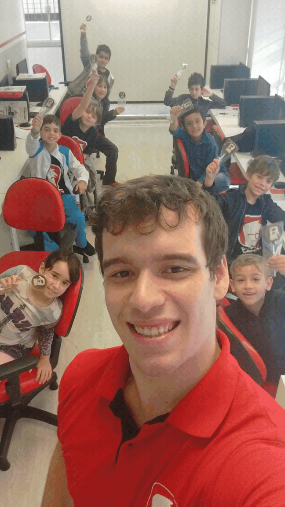

<h2 align="center">
   
  
   
  Renato Lima
   
</h2>

  <em>Game dev &amp; researcher · I've been building games that teach without being boring since 2013 — before it had a name</em>  
  Founder of <a href="https://conkist.me">Conkist</a> &nbsp;·&nbsp; Brazil / Europe

  
  &nbsp;
  
  &nbsp;
  
  &nbsp;
  

---

## About

I started building games in undergrad because I saw a gap: CS education was abstract, disconnected from the things students actually wanted to make. My thesis was a Unity game with an in-game terminal and a custom scripting language — before "serious games" was a phrase I knew.

That gap is still there. I've spent the last decade making commercial games, researching how games can be more meaningful, and building [Conkist](https://conkist.me) — the company doing both.

> *Evolve with more joy.*

---

## Portfolio

  
  
  

Commercial projects · 2019–2023

### Public Repos

| Project | What it is |
|---|---|
| [Virtual Justice](https://github.com/renatoconkist/Virtual-Justice) | Undergraduate thesis — Unity game with in-game programming terminal and custom scripting language (CESUPA, 2014) |
| [AsteroidZ](https://github.com/renatoconkist/AsteroidZ) | Portfolio & architecture study — clean Unity 2D project structure, ScriptableObjects, New Input System |
| [DungeonSweeper](https://github.com/renatoconkist/DungeonSweeper) | Vampire Survivors template — Visual Scripting (Bolt) study resource with documented extension points |
| [WhoIsAGoodBoy](https://github.com/renatoconkist/WhoIsAGoodBoy) | Global Game Jam 2021 — asymmetric 2-player party game, dog vs. owner |

---

## Research

<!-- ORCID-WORKS:START -->
| Year | Title | Venue |
|---|---|---|
| 2026 | [ECO-STICK: Integrated control with ecological elements for interactive solutions in the Amazon](https://doi.org/10.1145/3788851.3815049) | ACM |
| 2026 | [Project SmartAvatar: A Human-Avatar Interface](https://doi.org/10.1145/3788851.3815043) | ACM |
| 2025 | [GeoModel: Technology and Innovation for a Diverse and Interactive Geometric Education](https://doi.org/10.1145/3706370.3731710) | ACM |
<!-- ORCID-WORKS:END -->

Auto-updated from <a href="https://orcid.org/0009-0005-5678-2210">ORCID ↗</a>

---

## Tech Stack

   
   
  

---

## Connect

  
  &nbsp;
  
  &nbsp;
  

